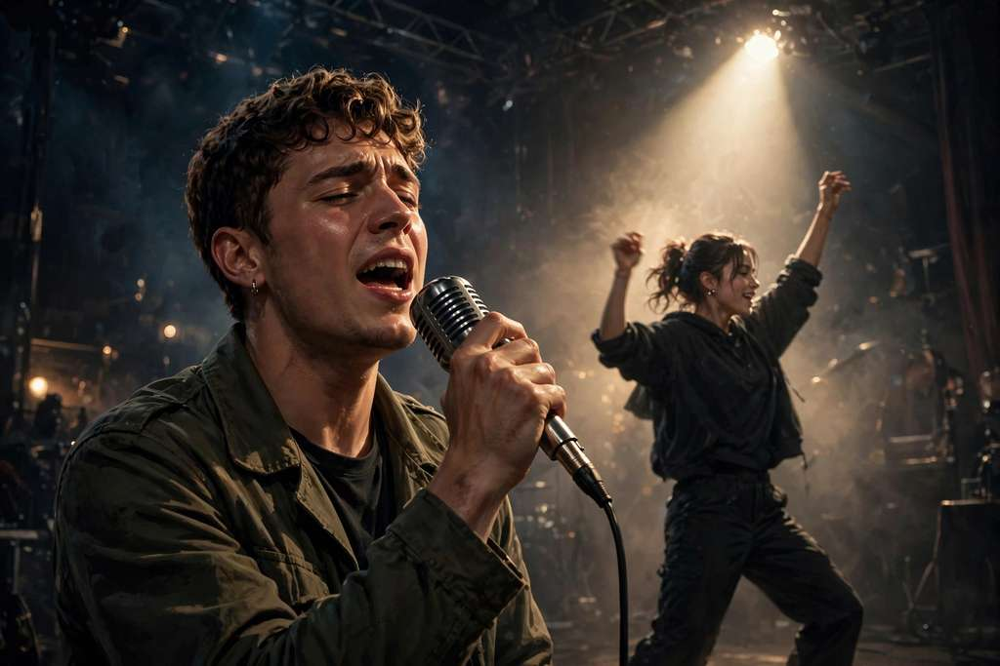

# Burning Bridges AI Video

**Your photo. The whole party.**

一张照片 → 派对入场 AI 短片 · chandelier 灯光 · 举杯时刻

From **$4.99** · no subscription

Independent AI video fan tool — no affiliation with Drake or any label. Upload only photos, reference videos and music you have permission to use. Concept artwork on this page illustrates the idea, not a guaranteed result.

## Links

|  | URL |
| --- | --- |
| **App** | https://aiburningbridges.online |
| **This landing** | https://majiatools.github.io/ai-burning-bridges/ |

## Demo

Trend reference clips — these videos show the trend; generated results will differ:

- [The party scene](https://burning-bridgesai.com/examples/blond-bowl-cut-29s-v2.mp4)
- [The animal party](https://burning-bridgesai.com/examples/raccoon-party-15s.mp4)
- [An unexpected character](https://burning-bridgesai.com/examples/office-crew-15s.mp4)

## What it does

- **One photo** + a party template → a chandelier-lit party video where your character leads: a raised cup, a camera close to the crowd, one lead in a room full of energy
- **Six ways to enter the party** — templates for a personal edit, an unexpected animal, or an original character (each opens its own photo-prep guide)
- **720p / 1080p / 4K** — 1 credit/sec at 720p, 2 credits/sec at 1080p, 6 credits/sec at 4K; the motion reference sets length and frame (e.g. 16:9 · 15s)
- One subject per video; **no free generation tier** — the quote is shown before you generate, and confirmed failures return credits

## Pricing

| Pack | Price | Credits |
| --- | --- | --- |
| First take | $4.99 USD | 20 credits |
| A few good takes | $12.99 USD | 80 credits |
| The director's pack | $24.99 USD | 200 credits |

One-time credit packs, no subscription. Shorter clips return unused credits — you never pay more than your quote.

## How to use

1. Open https://aiburningbridges.online and choose a party template
2. Prepare one front-facing head-and-torso photo (JPG/PNG/WebP, up to 10 MB, at least 300×300 px) and match the template's reference frame and quality
3. Sign in, review the quoted credits, generate, then follow your task in My videos and download the MP4

## License

Demo media for product showcase. Site © lynsea.
